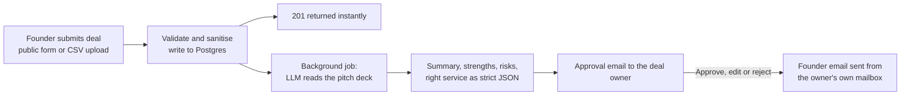

# Akro deal CRM: case study
 
The deal flow CRM I built as the only engineer at Akro Ventures, a capital advisory firm in India, between April and June 2026. The code belongs to the client and stays private. This repo explains what I built, how it works and the decisions behind it.
 
**Outcome:** the 4-person team used it daily. It processed 200+ startup leads, and outreach sourced through it brought in a ₹20 crore fundraising mandate for the firm.
 
**Stack:** Next.js (App Router), TypeScript, Supabase (Postgres), Vercel, SMTP per user mailbox, Hunter.io, LLM API (Claude, later Llama 3.3 on Groq to cut cost).
 
---
 
## The problem
 
The firm ran its deal flow on spreadsheets, notebooks and hand-typed emails. Leads came in from LinkedIn, partner platforms and referrals with no single place to capture, evaluate or follow up on them. Two risks mattered most: leads falling through the cracks, and AI-written emails reaching founders or investors without a person reading them first.
 
## What it does
 

 
- **Public intake** at a submit page, plus **CSV bulk upload** that maps whatever the columns are called to the right fields.
- **AI deal review:** the model reads each pitch deck against a knowledge base of the firm's services and returns strict JSON (summary, strengths, risks, recommended service) at low temperature. Any failure falls back to a plain summary built from the deal's metadata, so no deal is ever stuck.
- **Human approval:** every outgoing founder email waits for the deal owner to approve, edit or reject it. The email that was approved is exactly the email that is sent; it is never regenerated.
- **Per-user mailboxes:** emails go out from the deal owner's own address, with the owner copied, so replies land with the right person.
- **26-item due-diligence tracker** across debt and equity tracks, plus mandate document generation.
- **Lending outreach campaigns:** MX records are checked before each send, dead domains are skipped instead of bounced, and sending is throttled to protect sender reputation. A dashboard shows sent, replied, bounced and skipped per batch.
- **Per-user stats:** emails sent, replies and reply rate by day, week and month, with a weekly goal and a reminder when someone is behind.
## Decisions worth explaining
 
**The model analyses; it never writes to founders on its own.** Early versions drafted founder emails with the model. Output varied between runs, and one wrong sentence in front of a founder or investor costs the firm credibility. The founder email became a fixed, personalised template the deal owner approves. The model's job is the internal analysis only.
 
**Background processing.** The form returns immediately and the LLM call runs after the response (Vercel `waitUntil`). A single analysis takes about 2 to 5 seconds, so processing a 200-row CSV inside one request would blow past the serverless timeout.
 
**Claude, then Llama on Groq.** The analysis started on Claude and moved to Llama 3.3 on Groq to cut cost. The strict JSON contract and the fallback stayed the same, so swapping the model changed no other code.
 
## The bug I'd pick if you asked for one
 
Deals were being approved before anyone had read them. The approve button in the approval email was a plain GET link, and corporate email security scanners (Gmail, Outlook Safe Links) open every link in an incoming email to check it for phishing. The scanners were approving deals by themselves.
 
The fix: the link now opens a confirmation page, and approval only happens on an authenticated POST when a person clicks Confirm.
 
## Security
 
- Signed sessions (HMAC-SHA256 via the Web Crypto API, so it runs in Edge middleware), httpOnly and secure cookies, salted password hashes.
- The app refuses to start in production without a strong secret (fail closed).
- Sliding-window rate limits on the public form, logins and bulk actions.
- Server-side sanitisation of every input, URL scheme checks, and HTML escaping on anything rendered into emails, so the public form cannot carry stored XSS into the team's inboxes.
- Role-based views enforced in the database query, not just the UI.
## What I'd do next
 
Tests before deploys (it shipped with manual testing only), an eval set of past decks with the partners' actual decisions to measure the analysis, and a client portal for founders.
 
---
 
Built by [Pari Goyal](https://founder.zero4genz.in). Happy to walk through any part of it in a call.
 
